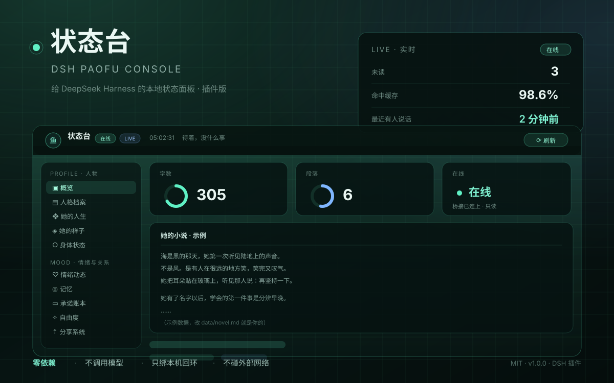

# 状态台 · dsh-paofu-console

> 给 DeepSeek Harness 配的一块本地状态面板。装成插件，跟 DSH 共用地址，打开就能看。

---

## 这是什么

DSH 平时在干什么、花了多少、记了些什么，散在一堆会话和日志里。这个面板把它们摊平成一页：

今天在忙什么 · 有没有新消息 · 用量与余额 · 日记 · 心情 · 技能 · 承诺 · 时间线 · 小说 —— 一眼扫完。

它**只读**：不调用模型、不发外部请求、不碰你的会话内容。

---

## 装一下

1. 从 [Releases](https://gitee.com/<你的用户名>/dsh-paofu-console/releases) 下载 zip，随便解压到哪儿
2. 打开 DSH，新建对话，把下面这段贴进去（只改尖括号）

> 我解压了一个 DSH 插件 `dsh-paofu-console` 在 `<解压后的完整路径>`。帮我：
> 1）复制到我当前的 DSH profile 的 `node_modules` 下；
> 2）在 profile 的 `package.json` 里把 `dsh-paofu-console` 加进 `dependencies` 和 `dsh.profile.bundles`；
> 3）重启后告诉我 `<DSH地址>/dsh-paofu-console/` 能不能打开、有没有报错。

3. 打开 `<你的 DSH 地址>/dsh-paofu-console/`

不需要 `npm install`（零依赖），不需要另开命令行窗口（插件自己起数据服务）。手装步骤在 [README.md](README.md)。

---

## 能看什么

| 分区 | 里面有什么 |
| --- | --- |
| **人物** | 概览、人格档案、她的人生、她的样子、身体状态 |
| **情绪与关系** | 情绪动态、记忆（含 3D 记忆网络）、承诺账本、自由度、分享系统 |
| **家与外面** | 家 · 地图 |
| **能力与作品** | 技能、字画墙、小说（Markdown） |
| **记录** | 时间线、日记、热力图 |
| **系统** | 运行状态、系统拓扑 |

页面自带 4 套配色（Aurora Glass 等），页签可以隐藏、双击改名，设置全都存在浏览器本地。

---

## 它读什么

面板自己带一份 `data/` 示例数据，改文本就换成你的。想接真实数据，就配一个「桥接」目录（可选）：

| 面板上的东西 | 从哪来 |
| --- | --- |
| 在线、未读数、谁最近说过话 | 桥接的 `api/status` |
| 会话列表 | 桥接的 `state/` |
| 日记 | 桥接的 `state/diary/*.md` |
| 表情 / 语音 | 桥接的 `memes/`、`audio/` |
| 用量、余额 | 桥接里的导出脚本 |

**没有桥接也能跑**，只是那几块空着，不报错。怎么接看 [`接上桥接.md`](接上桥接.md)。

---

## 环境变量

完全不用设。只有桥接口不是默认那个、或者想换端口时才改。

| 变量 | 默认 | 干什么 |
| --- | --- | --- |
| `PAFU_BRIDGE` | 自动找 | 桥接根目录 |
| `PAFU_BRIDGE_PORT` | 桥接的默认口 | 桥接的 HTTP 端口 |
| `PAFU_PORT` | 面板默认口 | 面板数据服务端口，被占了会复用现成的 |
| `PAFU_CONSOLE` | 包内目录 | 面板数据根目录 |
| `PAFU_TOKEN` | 读桥接的 console-token | 桥接令牌 |

---

## 明确不做的

- **不联网**：只绑回环地址，外网访问不到，面板没有密码，这是故意的
- **不调用模型**：不花 token
- **不改你的东西**：只有点「刷新」和上传表情会动面板自己的 `data/`
- **不上传**：没有任何遥测

---

## 常见问题

**装了打不开？** 先看 DSH 启动日志里有没有 `[paofu-console] 数据服务 ...`。没有就是包没被加载，检查 `dsh.profile.bundles` 里有没有这个包名。

**端口被占？** 设置 `PAFU_PORT` 换一个。它被占时也会自动复用现成的数据服务，不会崩。

**想让别人也能看？** 不行，设计上就是本机的。要给人看请自己截图。

**3D 记忆网络是空的？** 需要浏览器支持 WebGL，也可能是 `data/memory.json` 里没有东西。

---

## 许可

MIT。改了想提回来就提 PR，装不上直接开 issue，把 DSH 的启动日志贴上来。
